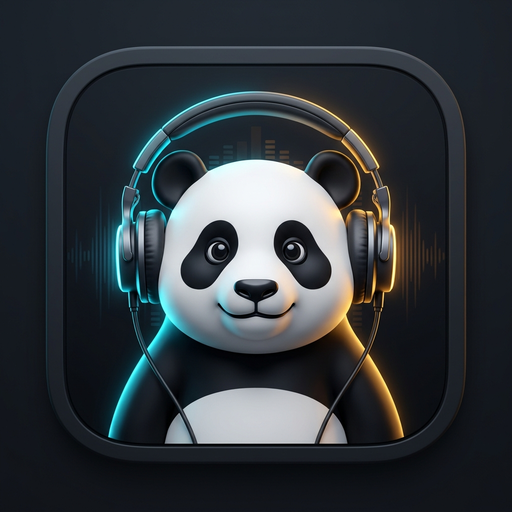
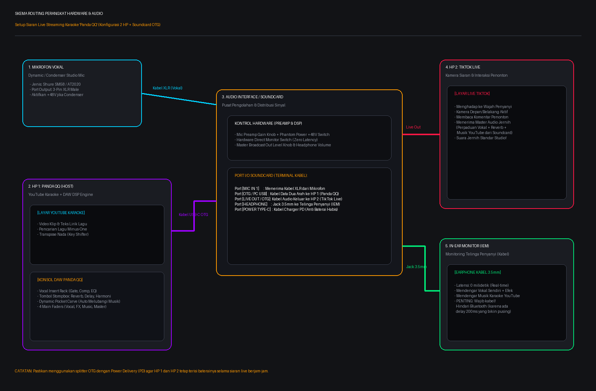

# 🐼 Panda QQ - Mobile Karaoke DAW & Live Streaming Suite

<p align="center">
  
</p>

<p align="center">
  <b>Aplikasi Studio DAW & Konsol Karaoke Mobile untuk Siaran Live TikTok, YouTube, & Instagram</b><br>
  <i>Audio Jernih Standar Broadcast • Zero-Latency C++20 DSP • Full-Duplex USB OTG Routing</i>
</p>

<p align="center">
  
  
  
  
  
</p>

---

## 📸 Skema Routing Perangkat (Setup 2 HP + Soundcard OTG)

Untuk mendapatkan hasil siaran berstandar audio studio profesional tanpa *feedback*, tanpa latensi, dan tanpa suara kaleng, gunakan konfigurasi perkabelan berikut:

<p align="center">
  
</p>

> 💡 **Panduan Teknis Lengkap**: Baca dokumen [docs/skema_routing_perangkat.md](docs/skema_routing_perangkat.md) untuk detail perkabelan port demi port.

---

## 🌟 Fitur-Fitur Utama Panda QQ

### 1. Antarmuka Mobile Ergonomis (Split-Screen)
- **Layar Atas (16:9 ~220 dp)**: Pemutar video & teks lirik YouTube karaoke dengan tombol *Search Modal* (anti-rusak saat keyboard virtual muncul) dan *Digital Key Transpose* (`-3` s/d `+3` semitone).
- **Preset Bar 1-Sentuh**: Tombol instan `[🎤 SAPA]`, `[✨ POP]`, `[🎸 AKUSTIK]`, `[💃 DANGDUT]`, dan `[🔥 RnB]` untuk pemula.
- **Tombol Cepat Send FX (Stompbox Strip)**:
  - `[✨ REVERB]`: Menghidupkan/mematikan ruang gema vokal secara instan.
  - `[🔁 DELAY]`: Pantulan echo stereo ping-pong tempo-sync.
  - `[👥 HARMONI]`: Backing vocal paduan suara otomatis (aktifkan dengan 1 ketukan saat masuk bagian *Reff/Chorus*!).
  - `[🔊 SUB BASS]`: Synthesizer bass *Psychoacoustic Sub-Harmonic* untuk menebalkan dentuman beat drum/kendang musik YouTube.
- **4 Fader Utama (Drag-and-Drop Reorderable)**: Fader volume vertikal tebal untuk **Vokal**, **Efek Makro**, **Musik**, dan **Master Broadcast** dengan *Integrated 24-Segment LED dBFS Meter*. Posisi fader bisa dipindah bebas (sangat ramah untuk penyanyi bertangan kidal).

### 2. Studio Dynamic Vocal Insert Rack
- **Adaptive Noise Gate**: Menghilangkan dengung kipas angin/AC ruangan.
- **Split-Band De-Esser (5.5 - 8.5 kHz)**: Meredam desis tajam huruf "S" dan "T".
- **7-Band Musical Parametric EQ**: Membentuk karakter vokal tebal dan renyah.
- **Studio Opto/VCA Compressor**: Meratakan teriakan dan bisikan vokal dengan jarum *Gain Reduction (GR)* visual.
- **True-Peak Limiter (-1.0 dBTP)**: Mengunci output maksimal agar transmisi siaran ke penonton TikTok tidak pernah pecah (*anti-clipping*).

### 3. Music Conditioning Engine (YouTube)
- **Dynamic Vocal Pocket Carver (Pro-Q Style)**: Otomatis melubangi frekuensi musik di $1.5 - 3.5\text{ kHz}$ HANYA saat vokal bernyanyi, sehingga vokal terdengar megah di atas musik tanpa harus teriak.
- **Sidechain Auto-Ducker**: Volume musik otomatis mengecil $2-3\text{ dB}$ saat penyanyi berbicara menyapa penonton.

---

## 📥 Cara Download & Mengompilasi APK

### Metode 1: Download Langsung via GitHub Releases (Paling Mudah)
Setiap kali ada pembaruan rilis di repository ini, GitHub Actions akan otomatis mengompilasi APK:
1. Masuk ke tab **[Releases](../../releases)** di repository ini.
2. Unduh file **`PandaQQ-v1.0.0-debug.apk`** langsung dari browser HP Android Anda.
3. Ketuk file yang diunduh dan pilih **Install**.

### Metode 2: Kompilasi Lokal dengan Android Studio
1. Buka **Android Studio**.
2. Pilih **Open** ➔ arahkan ke folder `android/`.
3. Klik menu: **Build** ➔ **Build Bundle(s) / APK(s)** ➔ **Build APK(s)**.
4. File APK siap diambil di `android/app/build/outputs/apk/debug/app-debug.apk`.

---

## 🛠️ Menguji Core Audio DSP C++20 di Komputer

Core Audio Engine Panda QQ ditulis murni dalam C++20 tanpa alokasi memori dinamis di audio thread (*Zero-Allocation*). Anda dapat menguji dan mengukur performanya di Mac/Linux:

```bash
# Konfigurasi & Build
cmake -B build -G Ninja
cmake --build build

# Jalankan Unit Test
./build/test_dsp_engine

# Jalankan Stress & Latency Benchmark
./build/stress_and_benchmark_test
```
*Hasil Benchmark: Memproses audio 80,6x lebih cepat dari real-time dengan beban CPU hanya 1,24%!*

---

## 💖 Donasi & Dukungan Pengembang

Aplikasi ini dikembangkan dengan dedikasi penuh agar para kreator dan musisi live streaming dapat bernyanyi dengan kualitas audio studio tanpa biaya lisensi mahal. 

Jika aplikasi ini bermanfaat untuk siaran live Anda, dukung kami melalui:

<p align="center">
  <b>Nomor E-Wallet (DANA / GoPay / OVO):</b><br>
  <code style="font-size: 20px; font-weight: bold;">082116929992</code><br>
  <i>a/n Panda QQ Support</i>
</p>

- [📱 Kirim Bukti / Konfirmasi via WhatsApp](https://wa.me/6282116929992?text=Halo%20Admin%20Panda%20QQ%2C%20saya%20sudah%20mengirimkan%20donasi%20dukungan.)

---

## 📄 Lisensi
Didistribusikan di bawah lisensi [MIT License](LICENSE).
