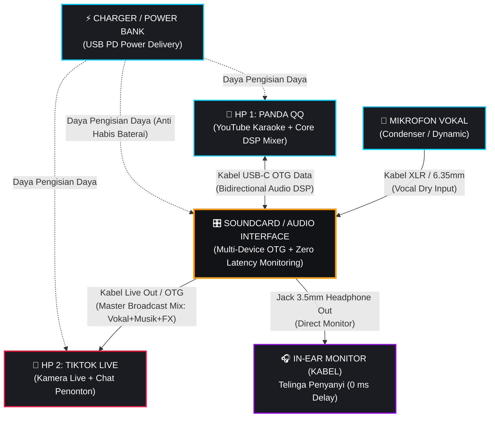

# SKEMA ROUTING PERANGKAT HARDWARE & AUDIO
## Setup Siaran Live Karaoke "Panda QQ" (2 HP + Soundcard OTG)

Dokumen ini menjelaskan konfigurasi kabel dan alur sinyal audio yang optimal untuk siaran live karaoke di TikTok/Instagram menggunakan aplikasi **Panda QQ**.

---

## 1. Diagram Alur Sinyal (Flowchart Routing)



---

## 2. Ilustrasi Visual Skema Hardware

*(Gambar diagram visual resolusi tinggi tersimpan di folder `docs/skema_routing_hardware.png`)*

```
┌─────────────────┐                                  ┌─────────────────┐
│ 🎤 MIKROFON     │                                  │ 📱 HP 2: TIKTOK │
│ (XLR / Jack)    │                                  │ (Kamera Siaran) │
└────────┬────────┘                                  └────────▲────────┘
         │ (Kabel XLR)                                        │ (Kabel Live Out)
         ▼                                                    │
┌─────────────────────────────────────────────────────────────┴────────┐
│             🎛️ SOUNDCARD / AUDIO INTERFACE (PUSAT ROUTING)            │
│                                                                      │
│  [Port Mic In]    [Port OTG / PC]    [Port Live Out]   [Port Headphone]│
└───────▲──────────────────┬──────────────────────────────────┬────────┘
        │                  │ (Kabel USB-C OTG)                │ (Jack 3.5mm)
        │                  ▼                                  ▼
        │        ┌───────────────────┐               ┌─────────────────┐
        │        │  📱 HP 1: PANDA QQ│               │ 🎧 IN-EAR       │
        │        │  (YouTube + Mixer)│               │    MONITOR (IEM)│
        │        └───────────────────┘               └─────────────────┘
        │
   (Suara Vokal Masuk ➔ Diproses DSP di HP 1 ➔ Dikirim ke HP 2 & Earphone)
```

---

## 3. Daftar Kabel & Port yang Wajib Disiapkan

| No | Dari Perangkat | Ke Perangkat | Jenis Kabel / Port | Keterangan Fungsi |
|---|---|---|---|---|
| **1** | **Mikrofon** | **Soundcard (Input 1)** | Kabel **XLR to XLR** (atau 6.35mm TS) | Mengalirkan suara vokal mentah ke preamp soundcard. Aktifkan **+48V** jika mic condenser. |
| **2** | **HP 1 (Panda QQ)** | **Soundcard (Port OTG / PC)** | Kabel **USB-C to USB-C OTG** | Mengirim audio YouTube ke mixer dan menerima vokal untuk diproses efek DAW C++. |
| **3** | **Soundcard (Live Out)** | **HP 2 (TikTok)** | Kabel **3.5mm TRRS to Type-C** (atau OTG Audio) | Mengirim hasil akhir (*Master Mix: Vokal + Reverb/Delay + Musik YouTube*) langsung ke penonton TikTok. |
| **4** | **Soundcard (Headphone)** | **Telinga Penyanyi** | Jack **3.5mm TRS In-Ear Monitor (Kabel)** | Mendengar vokal dan musik secara instan tanpa delay (**0 ms**). *Dilarang Bluetooth!* |
| **5** | **Charger / Powerbank** | **HP 1, HP 2, Soundcard** | Adaptor **USB Type-C Power Delivery (PD)** | Menjaga baterai kedua HP tetap terisi penuh selama siaran live 3–4 jam nonstop. |

---

## 4. Urutan Menghidupkan & Menguji Suara (Soundcheck 3 Menit)

1. **Langkah 1**: Colokkan mic, earphone IEM, dan kabel OTG ke HP 1 serta kabel Live Out ke HP 2.
2. **Langkah 2**: Buka aplikasi **Panda QQ** di HP 1. Putar salah satu lagu karaoke di layar YouTube atas.
3. **Langkah 3**: Tes bicara dan bernyanyi di mic sambil mendengarkan earphone.
   - Pastikan lampu LED meter di Fader Vokal dan Musik di Panda QQ menyala hijau/kuning.
   - Coba tombol cepat **`[✨ REVERB]`**, **`[🔁 DELAY]`**, dan **`[👥 HARMONI]`** untuk memastikan efek aktif.
4. **Langkah 4**: Buka aplikasi **TikTok** di HP 2 ➔ pilih **Go Live**.
   - Periksa ikon mikrofon eksternal di TikTok sudah aktif (bukan menggunakan mic internal HP 2).
5. **Siaran Live Siap Dimulai!** Anda dapat bernyanyi dengan percaya diri dengan audio berstandar siaran studio profesional.

